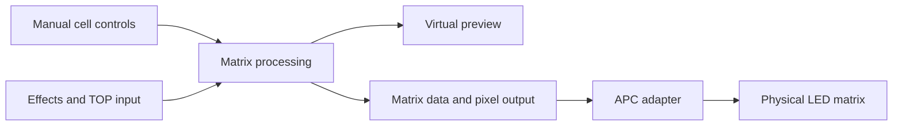

# Akai APC Mini Mk2 LED Controller

A TouchDesigner project for controlling the APC Mini Mk2 LED matrix. Individual cell colour and brightness, animated backgrounds and pad-triggered effects sit together in a virtual controller interface. The demonstrations show both the software and the physical controller.

## Watch the demonstrations

| Demonstration | What it shows | Length |
|---|---|---:|
| [Hands-on pad response](https://github.com/starphazed/akai-apc-mini-mk2-led-controller/releases/download/portfolio-demos-v1/hardware-06_hands_on_pad_response.mp4) | Physical pad presses alongside changing colour patterns | 13 s |
| [Individual cell painting](https://github.com/starphazed/akai-apc-mini-mk2-led-controller/releases/download/portfolio-demos-v1/virtual-01_individual_cell_painting.mp4) | Blue cells painted onto a red matrix | 16 s |
| [Animated backgrounds](https://github.com/starphazed/akai-apc-mini-mk2-led-controller/releases/download/portfolio-demos-v1/virtual-03_animated_background_presets.mp4) | Rainbow, Center ripple and Cycle in the interface | 12 s |

[All virtual demonstrations](documentation/virtual/README.md) · [All hardware demonstrations](documentation/hardware/README.md) · [Download the video collections](https://github.com/starphazed/akai-apc-mini-mk2-led-controller/releases/tag/portfolio-demos-v1)

## Features shown

- Individual cell colour and brightness controls, painting and Fill All.
- Manual, External and Add control modes.
- Animated backgrounds and reactive Ripple and Flash controls.
- Background and reactive speed, ring width and timing adjustments.
- IMAGE / TOP input displayed on the matrix.
- Physical pad interactions with visible LED responses.

## How it works

The project combines manual cell controls and external visual sources in the matrix processing section. Matrix data feeds the virtual preview and output path. The APC adapter connects the project to the physical controller.

This diagram summarises the modules; the screenshot below shows the inspected node network.

[Input, processing and output close-ups](documentation/screenshots/README.md)

## Run the project

The documented session used **TouchDesigner 2025.33230 on Windows**. Physical demonstrations use an **Akai APC Mini Mk2** connected over USB. Other versions have not been checked for this documentation.

1. Download the repository with **Code → Download ZIP**, then extract it.
2. Recommended: drag [`apc_mini_mk2_effects.tox`](project/apc_mini_mk2_effects.tox) into a TouchDesigner network. This reusable component starts with MIDI disabled.
3. Enter the imported `lighting_matrix_demo` component, right-click `controller_ui`, and choose **View**.
4. Select **Manual** to edit cells, or choose a background and a reactive effect.
5. For physical output, connect the APC Mini Mk2 over USB, verify the device name, then click **Connect APC**.

Alternatively, open [`APC_Mini_mk2_Layer_Controls.toe`](project/APC_Mini_mk2_Layer_Controls.toe) for the complete demo. **The `.toe` is saved with MIDI enabled and may send immediately.** Use only one active adapter per controller.

[Full startup and media-input instructions](project/README.md). No external Python packages or development scripts are needed for the supplied component in the documented environment. These binaries were copied unchanged; a fresh TouchDesigner launch was not performed during publication.

## Documentation

| Section | Contents |
|---|---|
| [Screenshots](documentation/screenshots/README.md) | Interface, cell control, node network and processing close-ups |
| [Virtual demonstrations](documentation/virtual/README.md) | Seven short screen recordings with source times |
| [Hardware demonstrations](documentation/hardware/README.md) | Eight clips of the physical controller |
| [Capture notes](documentation/CAPTURE_NOTES.md) | Editing, evidence and limitations |

Videos are release attachments, keeping large media out of the Git history. Screenshots and documentation live in the repository.
